# How to solve — Loop Puzzles

<!-- Generated by tools/build_how_to_solve.mjs from js/rating.js, docs/examples/examples.json, and docs/images/. -->

Every solving technique the Hint button knows across **Masyu**, **Slitherlink**, **Mid-loop**, **Hamilton cycle**, and **Hybrids** — grouped into shared loop fundamentals plus each puzzle’s own rules.
The same rule table powers both difficulty grading and live hints (see [README.md](../README.md)).

## Rules at a glance

Every puzzle in the collection shares one core objective: draw **one single closed loop** along the grid lines orthogonally, with no crossings or branches. Each puzzle family adds its own clue rules (and **Hybrids** books combine any two on the same board):

- **[Masyu](#masyu):** Visit every circle — go straight through white circles (○) and turn at an adjacent intersection; turn 90° at black circles (●) and go straight two segments in each direction.
- **[Slitherlink](#slitherlink):** Each number `0–3` inside a square tells how many of its four sides belong to the loop.
- **[Mid-loop](#mid-loop):** Pass straight through every teal dot (on intersections for even runs, or segment midpoints for odd runs) with equal straight length on both sides.
- **[Hamilton cycle](#hamilton-cycle):** Visit every active intersection dot on the grid, respecting any given lines and walls.
- **[Modifiers & Hybrids](#board-modifiers--hybrids):** Gray circles (mystery white/black), Swiss cheese cutout holes (each hole is entirely Inside or Outside), and two-ruleset hybrids where every puzzle genuinely needs both.

## How the examples work

Each illustration shows a position reached by following **Hint** from an empty board, together with the Hint button’s own highlights, ghost marks, and explanation.
The example puzzles live in a hidden book (`data/armory.csv`, `"hidden": true` in `data/manifest.json`); click any picture to open that exact puzzle in the app (`index.html?book=armory&puzzle=N`).

## Loop fundamentals

These shared techniques apply to **every** puzzle family — Masyu, Slitherlink, Mid-loop, Hamilton cycle, and all Hybrids. A puzzle’s overall difficulty (**Beginner**, **Medium**, **Hard**, or **Expert**) is set by the highest tier among all required steps (both loop fundamentals and puzzle-specific rules).

### Bookkeeping

5 core bookkeeping rules cost 1 each and run automatically before each hint step so the board stays tidy:

- `edgesOffCellOff` (cost 1): A segment touching an off-loop cell is off.
- `edgeEnds` (cost 1): A segment puts both of its cells on the loop.
- `fullCell` (cost 1): A cell with two segments takes no more.
- `isolatedCellOff` (cost 1): A cell with all its edges off is not on the loop.
- `closedLoopRestOff` (cost 1): Once the single loop is closed, all remaining cells are off the loop.

### Beginner

A puzzle is rated **Beginner** when its hardest required step is in this tier: direct local deductions — basic clue rules, dead ends, forced exits, and not closing the loop early.

#### deadEnd

*Beginner, cost 4*

An empty cell with fewer than two exits left cannot be on the loop.

*ARMORY-16 (5×5, after 4 earlier hints). Click the picture to open this puzzle in the app.*

> Hint says: "A5 has only one available exit left, so the loop cannot pass through it (cross out A5–B5)."

---

#### forcedExits

*Beginner, cost 4*

A loop cell with only two exits left must use both.

*ARMORY-11 (5×5, after 6 earlier hints). Click the picture to open this puzzle in the app.*

> Hint says: "A1 is on the loop and has only two exits left, so it must use A1–B1."

---

#### noEarlyClose

*Beginner, cost 6*

A segment joining the two ends of one path would close the loop early.

*ARMORY-18 (5×5, after 12 earlier hints). Click the picture to open this puzzle in the app.*

> Hint says: "A3 and B3 are the two ends of the same open path while other loop cells lie outside it, so A3–B3 cannot connect them."

---

### Medium

A puzzle is rated **Medium** when its hardest required step is in this tier: multi-step local patterns, basic border-anchored Inside/Outside shading, and 1-step local lookahead.

#### closingCell

*Medium, cost 11*

An empty cell whose only two exits meet one path cannot be on the loop.

*ARMORY-25 (6×6, after 17 earlier hints). Click the picture to open this puzzle in the app.*

> Hint says: "E3 has only two exits left, and both lead to the ends of one path (E4 and D3): using it would close the loop early, so cross out E3–E4 and D3–E3."

---

#### samePathExits

*Medium, cost 11*

A loop cell with three exits where two meet one path must use the third.

*ARMORY-26 (8×8, after 11 earlier hints). Click the picture to open this puzzle in the app.*

> Hint says: "B2 is on the loop with three exits, and two of them (B1 and A2) lead to the ends of one path; using both would close the loop early, so it must take B2–C2."

---

#### faceShade

*Medium, cost 18*

Basic inside/outside shading (crossing lines and X marks from the border) puts known colors on both sides of an edge.

<a href="../index.html?book=armory&puzzle=35">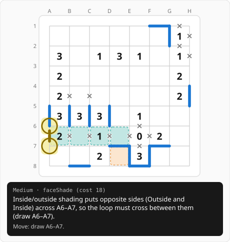</a>

*ARMORY-35 (8×8, after 16 earlier hints). Click the picture to open this puzzle in the app.*

> Hint says: "Inside/outside shading puts Outside on both sides of F1–G1, so the loop cannot pass between them (cross out F1–G1)."

---

#### boxStrand

*Medium, cost 20*

Closing two active corners of a 2×2 square cannot seal off both escapes of an open end on the opposite side.

*ARMORY-37 (8×8, after 35 earlier hints). Click the picture to open this puzzle in the app.*

> Hint says: "Drawing G4–G5 would fill both G4 and G5, sealing both escapes of the adjacent pair H4–H5 and stranding the open end at H4; so cross out G4–G5."

---

#### imagineLocal

*Medium, cost 22–28 (dynamic)*

Imagine a segment on or off at a circle or open end: one local step immediately breaks a rule.

*ARMORY-48 (7×7, after 42 earlier hints). Click the picture to open this puzzle in the app.*

> Hint says: "Imagine a segment at B3–B4: then the Mid-loop dot at B4–B5 must extend symmetrically vertically; and finally the Mid-loop dot at A5–A6 has no valid symmetric straight segment. So cross out B3–B4."

---

### Hard

A puzzle is rated **Hard** when its hardest required step is in this tier: clue-powered Inside/Outside shading, global loop topology (corridors, chokepoints, parity), symmetry, and short single-thread lookahead.

#### corridorNoEarlyClose

*Hard, cost 30*

A forced multi-cell corridor joining the two ends of one path would close the loop early.

<a href="../index.html?book=armory&puzzle=38">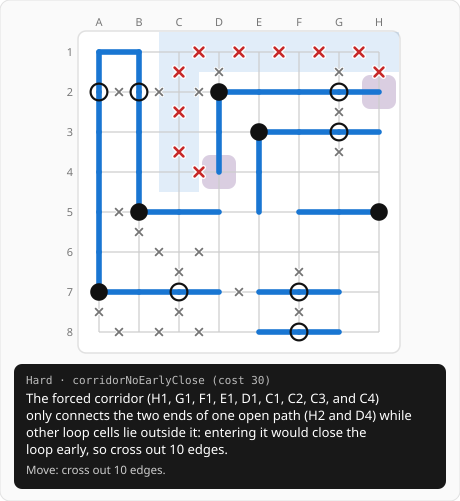</a>

*ARMORY-38 (8×8, after 25 earlier hints). Click the picture to open this puzzle in the app.*

> Hint says: "The forced corridor (H1, G1, F1, E1, D1, C1, C2, C3, and C4) only connects the two ends of one open path (H2 and D4) while other loop cells lie outside it: entering it would close the loop early, so cross out 10 edges."

---

#### faceCircle

*Hard, cost 38*

Advanced inside/outside shading (white-circle or Mid-loop diagonals, black 3-to-1 corners, or relative coloring) forces an edge.

*ARMORY-40 (8×8, after 22 earlier hints). Click the picture to open this puzzle in the app.*

> Hint says: "Circle shading: crossing line C1–D1 makes C1–D2 Inside; crossing line H4–H5 makes G4–H5 Inside; crossing ✕ at G4–G5 keeps F4–G5 Inside; flipping diagonally across white circle F5 makes E5–F6 Outside (+3 more steps). That puts opposite sides (Inside and Outside) across C2–D2, so draw C2–D2."

---

#### twoEndsJoin

*Hard, cost 44*

A sealed area with just two open ends must connect them, so their far ends cannot join early.

*ARMORY-35 (8×8, after 20 earlier hints). Click the picture to open this puzzle in the app.*

> Hint says: "The highlighted area has only two open ends (G2 and H2), so they must connect inside it; that makes G4 and H4 ends of one path, so G4–H4 cannot close them early."

---

#### chokepoint

*Hard, cost 48*

Blocking this segment would cut off a small area or leave a single chokepoint cell.

<a href="../index.html?book=armory&puzzle=42">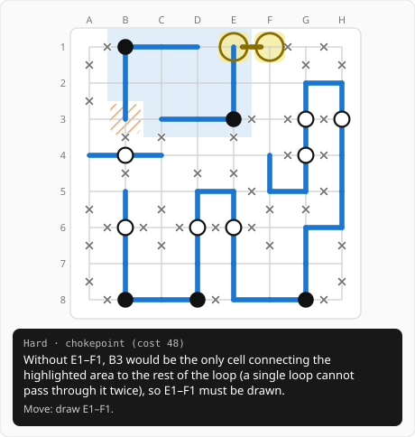</a>

*ARMORY-42 (8×8, after 17 earlier hints). Click the picture to open this puzzle in the app.*

> Hint says: "Without A5–A6, C8 would be the only cell connecting the highlighted area to the rest of the loop (a single loop cannot pass through it twice), so A5–A6 must be drawn."

---

#### parityPocket

*Hard, cost 52*

The other choice would seal off a small pocket with an odd number of open ends.

<a href="../index.html?book=armory&puzzle=43">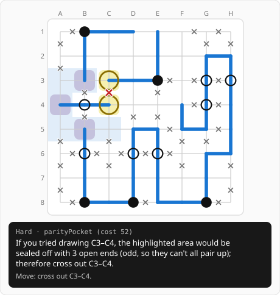</a>

*ARMORY-43 (8×8, after 46 earlier hints). Click the picture to open this puzzle in the app.*

> Hint says: "If you tried drawing C3–C4, the highlighted area would be sealed off with 3 open ends (odd, so they can't all pair up); therefore cross out C3–C4."

---

#### imagineTrace

*Hard, cost 36–75 (dynamic)*

Imagine a segment on or off and trace one single thread 2–3 steps ahead until something breaks.

*ARMORY-49 (10×10, after 57 earlier hints). Click the picture to open this puzzle in the app.*

> Hint says: "Imagine a segment at G8–G9: then the black circle at H8 is blocked left and goes two cells right; then I9 becomes a dead end; then H9 becomes a dead end; and finally G9 is left with only one way out. So cross out G8–G9."

---

#### crossingParity

*Hard, cost 58*

The loop crosses the border of any rectangle or band an even number of times.

*No puzzle in the current corpus needed this rule as its cheapest next hint yet (cheaper rules resolved those positions first).*

---

#### chokepointArea

*Hard, cost 64*

Blocking this segment would cut off a large area or leave a single chokepoint cell.

*ARMORY-44 (8×8, after 29 earlier hints). Click the picture to open this puzzle in the app.*

> Hint says: "Without E6–F6, D7 would be the only cell connecting the highlighted area to the rest of the loop (a single loop cannot pass through it twice), so E6–F6 must be drawn."

---

#### parityForces

*Hard, cost 68*

The other choice would seal off an area with an odd number of open ends.

*ARMORY-45 (10×10, after 53 earlier hints). Click the picture to open this puzzle in the app.*

> Hint says: "If you tried drawing E3–E4, the highlighted area would be sealed off with 5 open ends (odd, so they can't all pair up); therefore cross out E3–E4."

---

#### symmetry

*Hard, cost 70*

A puzzle with exact symmetry and a unique solution must have a symmetric loop.

*ARMORY-46 (6×6, after 17 earlier hints). Click the picture to open this puzzle in the app.*

> Hint says: "Because this puzzle has top-bottom mirror symmetry and a unique solution, the single loop must cross the mirror axis exactly twice (2 crossings already known), so cross out 4 edges."

---

### Expert

A puzzle is rated **Expert** when its hardest required step is in this tier: longer multi-front or area-parity lookahead chains and trial-and-contradiction deductions.

#### imagineChain

*Expert, cost ≥ 80 (dynamic)*

Imagine a segment on or off and follow a long, multi-front, or area-parity chain until something breaks.

<a href="../index.html?book=armory&puzzle=50">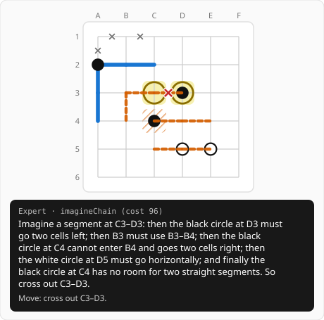</a>

*ARMORY-50 (7×7, after 19 earlier hints). Click the picture to open this puzzle in the app.*

> Hint says: "Imagine a segment at D1–D2: then E1–E2 cannot close the loop early; and finally the Mid-loop dot at D1–E1 has no valid symmetric straight segment. So cross out D1–D2."

---

#### tryEdge

*Expert, cost 120*

Trying a segment one way leads to a contradiction.

*ARMORY-47 (7×7, after 26 earlier hints). Click the picture to open this puzzle in the app.*

> Hint says: "Imagine no segment at B6–C6 and follow the forced deductions (starting with: inside/outside shading forces draw B5–B6; then connecting the two open ends forces cross out A5–B5; then A5 must use A4–A5; then B5 must use B4–B5; reaching a contradiction after 5 steps). So draw B6–C6."

---

## Masyu

**White circles (○):** pass straight through and turn 90° at least once at an adjacent intersection. **Black circles (●):** turn 90° at the circle and go straight for at least two segments in both exit directions.

### whiteStraight

*Beginner, cost 2*

A white circle blocked on one axis goes straight along the other.

*ARMORY-10 (5×5, the empty board). Click the picture to open this puzzle in the app.*

> Hint says: "The white circle at C1 cannot go vertically, so the loop must go straight horizontally through it."

---

### blackExtend

*Beginner, cost 2*

A black circle continues straight two cells from an existing segment and turns away from the opposite side.

<a href="../index.html?book=armory&puzzle=11">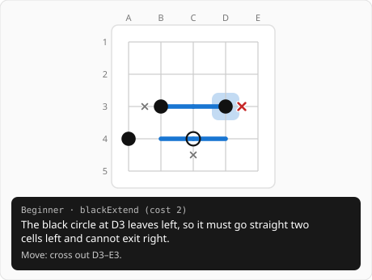</a>

*ARMORY-11 (5×5, after 2 earlier hints). Click the picture to open this puzzle in the app.*

> Hint says: "The black circle at A3 leaves up, so it must go straight two cells up and cannot exit down."

---

### blackWall

*Beginner, cost 2*

A black circle blocked within two cells of a wall or cross must extend two cells the opposite way.

*ARMORY-12 (5×5, the empty board). Click the picture to open this puzzle in the app.*

> Hint says: "The black circle at E2 is too close to the up edge to go two straight cells up, so it must go two cells down."

---

### blackAdjacent

*Beginner, cost 3*

Two touching black circles cannot connect, so each extends two cells away from the other.

<a href="../index.html?book=armory&puzzle=14">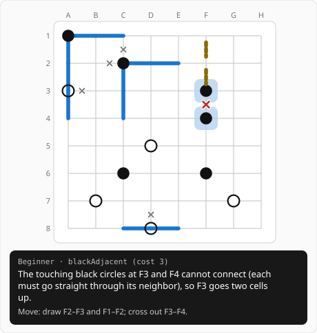</a>

*ARMORY-14 (8×8, after 7 earlier hints). Click the picture to open this puzzle in the app.*

> Hint says: "The touching black circles at D3 and D4 cannot connect (each must go straight through its neighbor), so D3 goes two cells up."

---

### whiteMustTurn

*Beginner, cost 3*

A white circle that goes straight at one end must turn at the other.

*ARMORY-15 (5×5, after 5 earlier hints). Click the picture to open this puzzle in the app.*

> Hint says: "The white circle at C2 goes straight through D2, so the loop must turn at B2 (cross out A2–B2)."

---

### blackPerp

*Beginner, cost 5*

A black circle cannot enter a neighbor that already has a perpendicular segment.

*ARMORY-17 (5×5, after 6 earlier hints). Click the picture to open this puzzle in the app.*

> Hint says: "The black circle at C3 cannot enter B3 (which already has a perpendicular segment), so it must go two cells right."

---

### threeWhites

*Beginner, cost 8*

Three white circles in a row must all cross perpendicular to the row.

*ARMORY-16 (5×5, after 9 earlier hints). Click the picture to open this puzzle in the app.*

> Hint says: "Three white circles in a row (D2, C2, and B2) cannot go along the row because the middle circle would fail to turn at either end; all three must cross vertically."

---

### whiteBothStraight

*Medium, cost 10*

A white circle cannot use an axis where both neighbors already continue straight.

<a href="../index.html?book=armory&puzzle=24">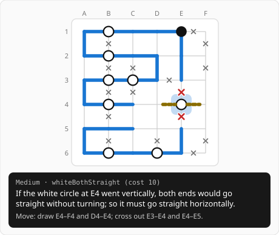</a>

*ARMORY-24 (6×6, after 22 earlier hints). Click the picture to open this puzzle in the app.*

> Hint says: "If the white circle at E4 went vertically, both ends would go straight without turning; so it must go straight horizontally."

---

### twoWhitesStraight

*Medium, cost 12*

Two touching white circles with a straight segment entering one cannot connect, so both cross perpendicular.

*ARMORY-27 (8×8, after 23 earlier hints). Click the picture to open this puzzle in the app.*

> Hint says: "The touching white circles at E4 and F4 cannot join because C4–D4 already continues straight past E4; both must go vertically."

---

### whiteNoTurnAxis

*Medium, cost 14*

A white circle cannot use an axis whose two neighbors are both unable to turn.

<a href="../index.html?book=armory&puzzle=29">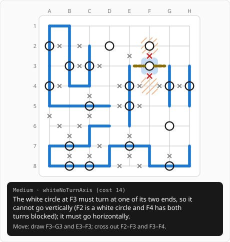</a>

*ARMORY-29 (8×8, after 34 earlier hints). Click the picture to open this puzzle in the app.*

> Hint says: "The white circle at F3 must turn at one of its two ends, so it cannot go vertically (F2 is a white circle and F4 has both turns blocked); it must go horizontally."

---

### blackNoEarlyClose

*Medium, cost 14*

A black circle cannot extend two cells into the other end of its own path and close the loop early.

*ARMORY-30 (8×8, after 22 earlier hints). Click the picture to open this puzzle in the app.*

> Hint says: "C3 and C1 are the two ends of one open path while other loop cells lie outside it, so the black circle at C3 cannot extend two cells up into C1; it must go two cells down."

---

### blackBlockedTarget

*Medium, cost 15*

A black circle cannot extend toward a circle two cells away that cannot accept a straight segment.

*No puzzle in the current corpus needed this rule as its cheapest next hint yet (cheaper rules resolved those positions first).*

---

### blackTwoDiagWhites

*Medium, cost 15*

A black circle flanked by two diagonally adjacent white circles cannot extend between them.

<a href="../index.html?book=armory&puzzle=31">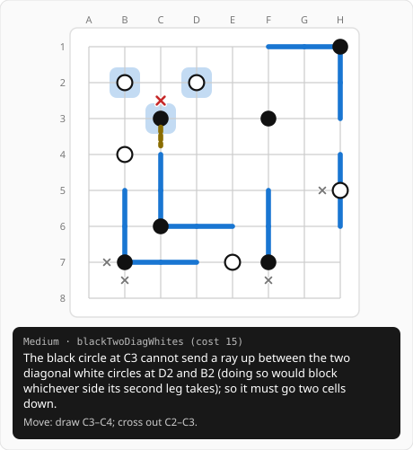</a>

*ARMORY-31 (8×8, after 20 earlier hints). Click the picture to open this puzzle in the app.*

> Hint says: "The black circle at F3 cannot send a ray right between the two diagonal white circles at G4 and G2 (doing so would block whichever side its second leg takes); so it must go two cells left."

---

### blackWhiteNoTurn

*Medium, cost 16*

A black circle cannot extend into a white circle two cells away whose far side cannot turn.

<a href="../index.html?book=armory&puzzle=32">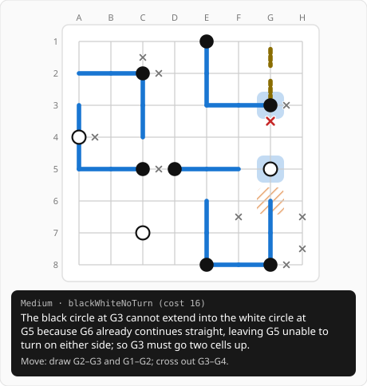</a>

*ARMORY-32 (8×8, after 13 earlier hints). Click the picture to open this puzzle in the app.*

> Hint says: "The black circle at G3 cannot extend into the white circle at G5 because G6 already continues straight, leaving G5 unable to turn on either side; so G3 must go two cells up."

---

### whiteCornerPinch

*Medium, cost 17*

A two-exit corner diagonally next to a white circle cannot pinch both of its already-active neighbors.

<a href="../index.html?book=armory&puzzle=33">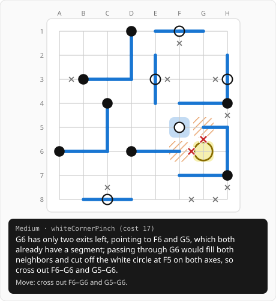</a>

*ARMORY-33 (8×8, after 16 earlier hints). Click the picture to open this puzzle in the app.*

> Hint says: "G6 has only two exits left, pointing to F6 and G5, which both already have a segment; passing through G6 would fill both neighbors and cut off the white circle at F5 on both axes, so cross out F6–G6 and G5–G6."

---

### whiteDeadEndPinch

*Medium, cost 17*

A segment completing two sides of a 2×2 square beside a white circle cannot pinch both of its axes.

<a href="../index.html?book=armory&puzzle=34">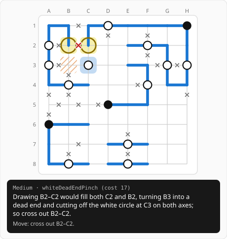</a>

*ARMORY-34 (8×8, after 30 earlier hints). Click the picture to open this puzzle in the app.*

> Hint says: "Drawing B2–C2 would fill both C2 and B2, turning B3 into a dead end and cutting off the white circle at C3 on both axes; so cross out B2–C2."

---

### Gray circles

Each gray circle is secretly either a **white** or a **black** circle — figuring out which is part of the puzzle. Tap a gray circle in the app to label it as an optional note.

- Bookkeeping: `grayFromShape` (cost 1): A gray circle with two drawn segments resolves to white (straight) or black (turn).

#### grayMustBeBlack

*Beginner, cost 2*

A gray circle that cannot go straight along either axis must be black.

*ARMORY-09 (8×8, the empty board). Click the picture to open this puzzle in the app.*

> Hint says: "The gray circle at A8 is in a corner and cannot go straight through, so it cannot be white — it must be a black circle."

---

#### grayMustBeWhite

*Beginner, cost 3*

A gray circle that cannot extend two straight segments along both axes must be white.

*ARMORY-13 (8×8, after 2 earlier hints). Click the picture to open this puzzle in the app.*

> Hint says: "The gray circle at H6 cannot be black because it lacks room for two straight segments horizontally — it must be a white circle."

---

#### grayWhiteNoTurn

*Medium, cost 12*

A gray circle that cannot make a valid white-circle turn on either axis must be black.

*ARMORY-28 (8×8, after 22 earlier hints). Click the picture to open this puzzle in the app.*

> Hint says: "If the gray circle at F4 were white, it could not make a required 90° turn on either axis; so it must be a black circle."

---

## Slitherlink

Each number **0–3** sits inside a grid square and tells how many of that square’s four sides belong to the single closed loop (blank squares can have any number of sides).

### slitherZero

*Beginner, cost 2*

A 0 square has no loop segments around it.

<a href="../index.html?book=armory&puzzle=1">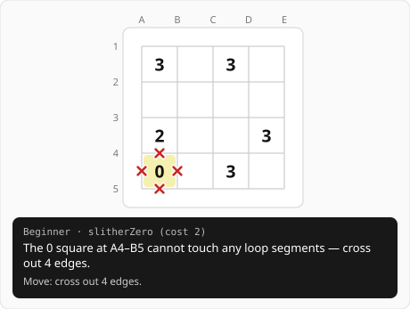</a>

*ARMORY-01 (5×5, the empty board). Click the picture to open this puzzle in the app.*

> Hint says: "The 0 square at A4–B5 cannot touch any loop segments — cross out 4 edges."

---

### slitherCount

*Beginner, cost 2*

A numbered square whose remaining edges match its count must fill or cross them out.

<a href="../index.html?book=armory&puzzle=2">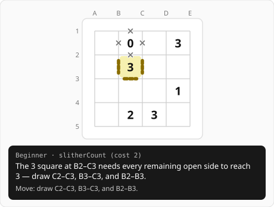</a>

*ARMORY-02 (5×5, after 1 earlier hint). Click the picture to open this puzzle in the app.*

> Hint says: "The 3 square at B2–C3 needs every remaining open side to reach 3 — draw C2–C3, B3–C3, and B2–B3."

---

### slitherCorner

*Beginner, cost 3*

A 3 or 1 at a blocked corner forces both of its corner sides on (for 3) or off (for 1).

<a href="../index.html?book=armory&puzzle=3">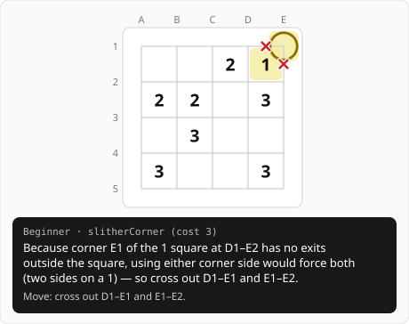</a>

*ARMORY-03 (5×5, the empty board). Click the picture to open this puzzle in the app.*

> Hint says: "Because corner E1 of the 1 square at D1–E2 has no exits outside the square, using either corner side would force both (two sides on a 1) — so cross out D1–E1 and E1–E2."

---

### slitherAdjacent3

*Beginner, cost 5*

Two orthogonally adjacent 3s force three parallel segments and cross out the shared-vertex extensions.

*ARMORY-04 (5×5, after 1 earlier hint). Click the picture to open this puzzle in the app.*

> Hint says: "Two orthogonally adjacent 3 squares (C2–D3 and D2–E3) must share their middle edge and use both opposite far sides without branching at their shared corners — draw D2–D3, C2–C3, and E2–E3; cross out D1–D2 and D3–D4."

---

### slitherDiag3

*Beginner, cost 6*

Two diagonally adjacent 3s force both outer corners on.

<a href="../index.html?book=armory&puzzle=5">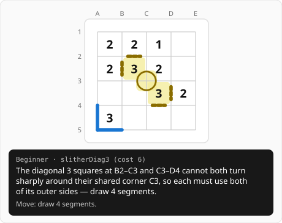</a>

*ARMORY-05 (5×5, after 1 earlier hint). Click the picture to open this puzzle in the app.*

> Hint says: "The diagonal 3 squares at B2–C3 and C3–D4 cannot both turn sharply around their shared corner C3, so each must use both of its outer sides — draw 4 segments."

---

### slitherLineIn

*Beginner, cost 6*

A segment entering a corner of a square with one spare side (e.g. a 3, or a 2 with one X) forces its other open sides on and blocks the other exit.

<a href="../index.html?book=armory&puzzle=4">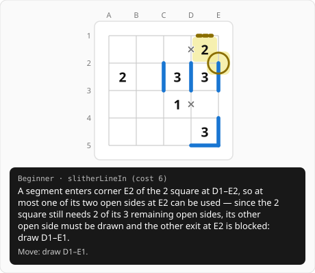</a>

*ARMORY-04 (5×5, after 2 earlier hints). Click the picture to open this puzzle in the app.*

> Hint says: "A segment enters corner E2 of the 2 square at D1–E2, so at most one of its two open sides at E2 can be used — since the 2 square still needs 2 of its 3 remaining open sides, its other open side must be drawn and the other exit at E2 is blocked: draw D1–E1."

---

### slitherCorner2

*Medium, cost 10*

A 2 at a blocked corner couples its two corner sides (both on or both off), forcing exits at its adjacent corners.

<a href="../index.html?book=armory&puzzle=19">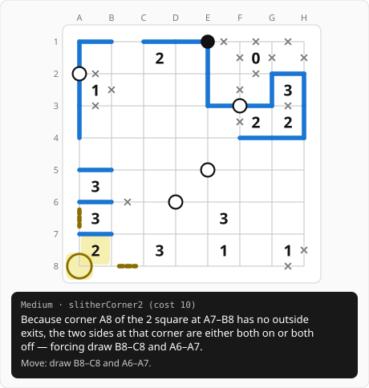</a>

*ARMORY-19 (8×8, after 18 earlier hints). Click the picture to open this puzzle in the app.*

> Hint says: "Because corner A8 of the 2 square at A7–B8 has no outside exits, the two sides at that corner are either both on or both off — forcing draw B8–C8 and A6–A7."

---

### slither1LineIn

*Medium, cost 12*

A segment forced into a corner of a 1 crosses out its two opposite sides.

*ARMORY-20 (8×8, after 27 earlier hints). Click the picture to open this puzzle in the app.*

> Hint says: "The segment at E7 must continue along one of the 1 square's two adjacent sides at E6–F7, using up its single segment — so its two opposite sides are off: cross out E6–F6 and F6–F7."

---

### slitherDiag32

*Medium, cost 14*

A diagonal chain of 2s between two 3s forces both outer corners on.

<a href="../index.html?book=armory&puzzle=21">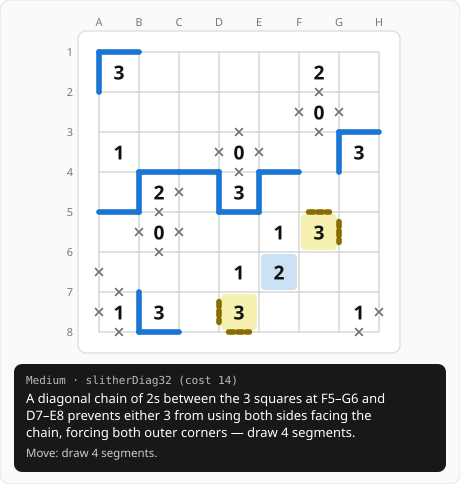</a>

*ARMORY-21 (9×9, after 2 earlier hints). Click the picture to open this puzzle in the app.*

> Hint says: "A diagonal chain of 2s between the 3 squares at G1–H2 and E3–F4 prevents either 3 from using both sides facing the chain, forcing both outer corners — draw 4 segments."

---

### faceSlither

*Hard, cost 30*

Inside/outside shading around numbered Slitherlink squares (and circles on hybrids) forces an edge.

<a href="../index.html?book=armory&puzzle=41">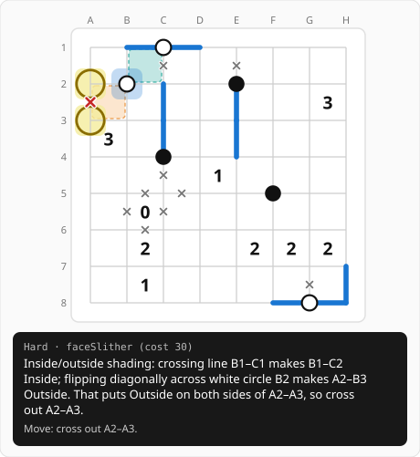</a>

*ARMORY-41 (6×18, after 27 earlier hints). Click the picture to open this puzzle in the app.*

> Hint says: "Inside/outside shading: even/odd parity around the 2 square B17–C18 makes A17–B18 Inside. That puts opposite sides (Outside and Inside) across A17–A18, so draw A17–A18."

---

## Mid-loop

Every teal dot sits either on an intersection (even straight run: 2, 4, …) or on a segment midpoint (odd straight run: 1, 3, …). The single closed loop must pass **straight through** every teal dot with **equal straight lengths** on both sides up to the 90° turns at each end. Because intersection dots always go straight through, diagonal Inside/Outside shading (`faceCircle`) also applies to them.

### midEdgeDot

*Beginner, cost 1*

A Mid-loop dot on a grid segment puts that segment on the loop.

<a href="../index.html?book=armory&puzzle=6">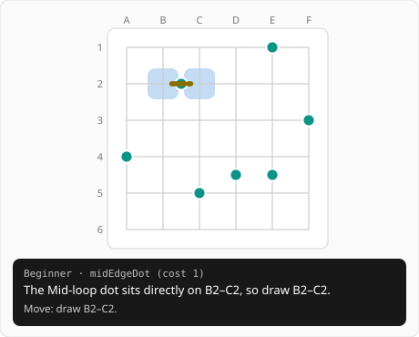</a>

*ARMORY-06 (6×6, the empty board). Click the picture to open this puzzle in the app.*

> Hint says: "The Mid-loop dot sits directly on B2–C2, so draw B2–C2."

---

### midVertexAxis

*Beginner, cost 3*

A Mid-loop dot on an intersection whose one direction is blocked goes straight the other way.

<a href="../index.html?book=armory&puzzle=7">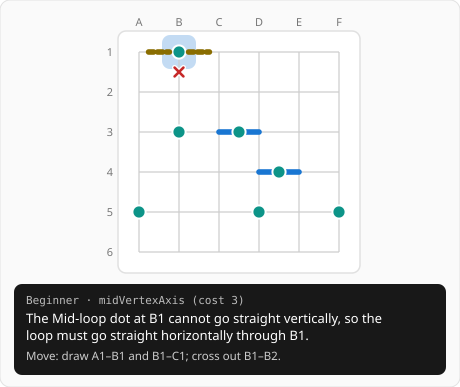</a>

*ARMORY-07 (6×6, after 2 earlier hints). Click the picture to open this puzzle in the app.*

> Hint says: "The Mid-loop dot at B1 cannot go straight vertically, so the loop must go straight horizontally through B1."

---

### midSymExtend

*Beginner, cost 4*

When a Mid-loop straight segment extends further on one side, extend the opposite side to match.

<a href="../index.html?book=armory&puzzle=6">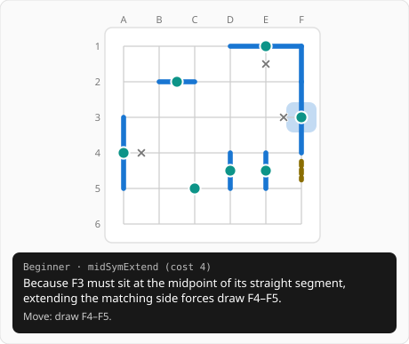</a>

*ARMORY-06 (6×6, after 7 earlier hints). Click the picture to open this puzzle in the app.*

> Hint says: "Because F3 must sit at the midpoint of its straight segment, extending the matching side forces draw F4–F5."

---

### midSymCap

*Beginner, cost 5*

When one side of a Mid-loop segment must turn, the matching distance on the opposite side must also turn.

<a href="../index.html?book=armory&puzzle=8">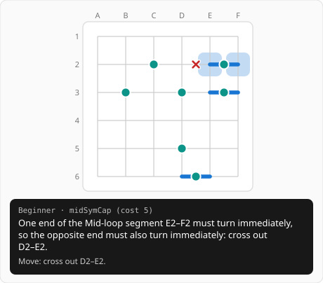</a>

*ARMORY-08 (6×6, after 7 earlier hints). Click the picture to open this puzzle in the app.*

> Hint says: "One side of the Mid-loop dot at B1–C1 cannot go further than 0 steps, so the opposite side must also turn there: cross out A1–B1."

---

### midLengthForce

*Medium, cost 11*

Eliminating impossible stop lengths along a Mid-loop dot forces its straight run to extend or turn.

<a href="../index.html?book=armory&puzzle=22">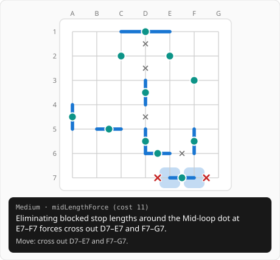</a>

*ARMORY-22 (7×7, after 22 earlier hints). Click the picture to open this puzzle in the app.*

> Hint says: "Eliminating blocked stop lengths around the Mid-loop dot at D2 forces cross out B2–C2 and E2–F2."

---

### midVertexParity

*Medium, cost 12*

An intersection Mid-loop dot with no valid symmetric length along one axis runs along the other.

<a href="../index.html?book=armory&puzzle=23">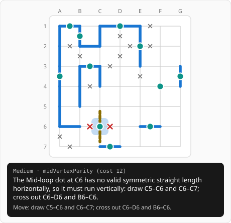</a>

*ARMORY-23 (7×7, after 28 earlier hints). Click the picture to open this puzzle in the app.*

> Hint says: "The Mid-loop dot at C6 has no valid symmetric straight length horizontally, so it must run vertically: draw C5–C6 and C6–C7; cross out C6–D6 and B6–C6."

---

## Hamilton cycle

The loop must visit **every** active intersection dot on the grid (none may be left empty). Dark pre-filled segments and bold **✕** walls are permanent givens.

### checkerPocket

*Medium, cost 18*

Checkerboard light/dark dot counts in a small full-board pocket force its exit segments.

*ARMORY-36 (8×8, after 10 earlier hints). Click the picture to open this puzzle in the app.*

> Hint says: "Checkerboard parity on the highlighted full-board region: light dots need 2 more segment ends and dark dots need 4 (difference 2), which forces draw D4–D5 and B6–C6; cross out B5–C5 and D6–D7."

---

### checkerParity

*Hard, cost 36*

Checkerboard light/dark dot counts in a full-board region force its exit segments.

*ARMORY-39 (6×7, after 12 earlier hints). Click the picture to open this puzzle in the app.*

> Hint says: "Checkerboard parity on the highlighted full-board region: light dots need 8 more segment ends and dark dots need 7 (difference 1), which forces draw A4–A5; cross out B4–B5."

---

## Board modifiers & Hybrids

### Swiss cheese

Cutout holes cannot be entered. Every enclosed hole lies entirely **Inside** or entirely **Outside** the loop (tap anywhere in a hole to shade it). All loop techniques — especially border rules, `chokepoint`, `faceShade`, `faceCircle`, and `faceSlither` — work naturally around and across interior holes.

### Hybrids

In **Hybrids** books, two clue families (such as Masyu + Hamilton cycle, Slitherlink + Masyu, Slitherlink + Hamilton cycle, Mid-loop + Masyu, Mid-loop + Slitherlink, or Mid-loop + Hamilton cycle) share one single closed loop, and every puzzle is verified to genuinely require both rule sets. Inside/Outside shading and Mid-loop ray constraints automatically combine across clue families.
