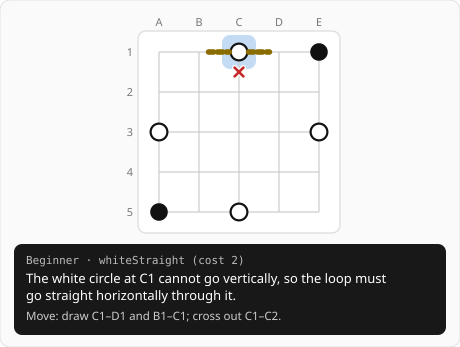
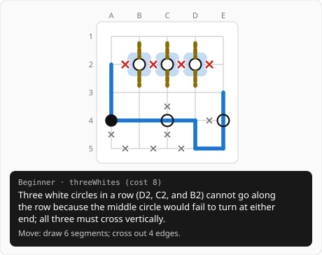
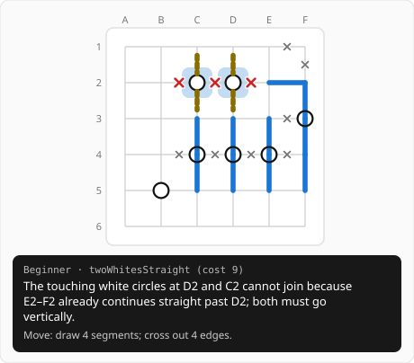
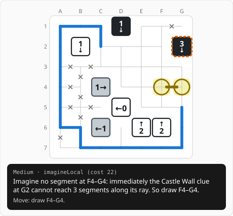
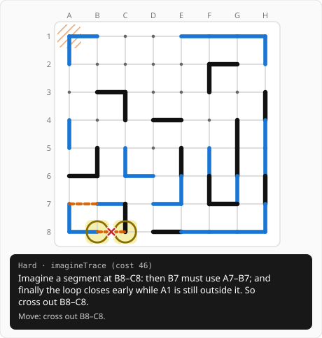
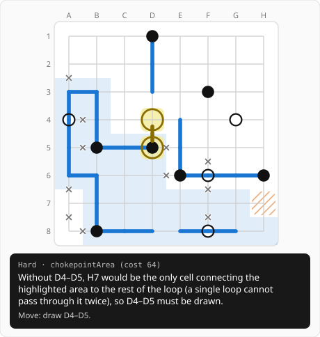

# How to solve Masyu

<!-- Generated by tools/build_how_to_solve.mjs from js/rating.js, docs/examples/examples.json, and docs/images/. -->

Every solving technique the Hint button knows, ordered from easiest to hardest, with an example of the hint at work.
The same rule table powers both difficulty grading and live hints (see [README.md](../README.md)).

## Rules of Masyu

- Draw **one single closed loop** along the grid lines orthogonally, with no crossings or branches.
- The loop must visit **every circle** (white and black). Empty intersections may or may not be visited.
- **White circle (○):** the loop goes **straight through** it, and must **turn 90°** at least once at the immediately adjacent intersections along the loop.
- **Black circle (●):** the loop **turns 90°** at it, and must go **straight through** both immediately adjacent intersections along the loop (at least two segments straight in each exit direction).

## How the examples work

Each illustration shows a position reached by following **Hint** from an empty board, together with the Hint button's own highlights, ghost marks, and explanation.
The example puzzles live in a hidden book (`data/armory.csv`, `"hidden": true` in `data/manifest.json`); click any picture to open that exact puzzle in the app (`index.html?book=armory&puzzle=N`).

## Bookkeeping

Five bookkeeping rules cost 1 each and run automatically before each hint step so the board stays tidy:

- `edgesOffCellOff` (cost 1): A segment touching an off-loop cell is off.
- `edgeEnds` (cost 1): A segment puts both of its cells on the loop.
- `fullCell` (cost 1): A cell with two segments takes no more.
- `isolatedCellOff` (cost 1): A cell with all its edges off is not on the loop.
- `closedLoopRestOff` (cost 1): Once the single loop is closed, all remaining cells are off the loop.

## Beginner

A puzzle is rated **Beginner** when its hardest required step is in this tier: basic circle rules, rows of three white circles, dead ends, forced exits, and not closing the loop early.

### whiteStraight

*Beginner, cost 2*

A white circle blocked on one axis goes straight along the other.

*ARMORY-01 (5×5, the empty board). Click the picture to open this puzzle in the app.*

> Hint says: "The white circle at C1 cannot go vertically, so the loop must go straight horizontally through it."

---

### blackExtend

*Beginner, cost 2*

A black circle continues straight two cells from an existing segment and turns away from the opposite side.

*ARMORY-02 (5×5, after 2 earlier hints). Click the picture to open this puzzle in the app.*

> Hint says: "The black circle at A3 leaves up, so it must go straight two cells up and cannot exit down."

---

### blackWall

*Beginner, cost 2*

A black circle blocked within two cells of a wall or cross must extend two cells the opposite way.

*ARMORY-03 (5×5, the empty board). Click the picture to open this puzzle in the app.*

> Hint says: "The black circle at B3 is too close to the left edge to go two straight cells left, so it must go two cells right."

---

### blackAdjacent

*Beginner, cost 3*

Two touching black circles cannot connect, so each extends two cells away from the other.

*ARMORY-04 (6×6, after 4 earlier hints). Click the picture to open this puzzle in the app.*

> Hint says: "The touching black circles at C4 and D4 cannot connect (each must go straight through its neighbor), so C4 goes two cells left."

---

### whiteMustTurn

*Beginner, cost 3*

A white circle that goes straight at one end must turn at the other.

*ARMORY-05 (5×5, after 5 earlier hints). Click the picture to open this puzzle in the app.*

> Hint says: "The white circle at C2 goes straight through D2, so the loop must turn at B2 (cross out A2–B2)."

---

### deadEnd

*Beginner, cost 4*

An empty cell with fewer than two exits left cannot be on the loop.

*ARMORY-06 (5×5, after 4 earlier hints). Click the picture to open this puzzle in the app.*

> Hint says: "A5 has only one available exit left, so the loop cannot pass through it (cross out A5–B5)."

---

### forcedExits

*Beginner, cost 4*

A loop cell with only two exits left must use both.

*ARMORY-02 (5×5, after 6 earlier hints). Click the picture to open this puzzle in the app.*

> Hint says: "A1 is on the loop and has only two exits left, so it must use A1–B1."

---

### blackPerp

*Beginner, cost 5*

A black circle cannot enter a neighbor that already has a perpendicular segment.

*ARMORY-07 (5×5, after 6 earlier hints). Click the picture to open this puzzle in the app.*

> Hint says: "The black circle at C3 cannot enter B3 (which already has a perpendicular segment), so it must go two cells right."

---

### noEarlyClose

*Beginner, cost 6*

A segment joining the two ends of one path would close the loop early.

*ARMORY-08 (5×5, after 12 earlier hints). Click the picture to open this puzzle in the app.*

> Hint says: "A3 and B3 are the two ends of the same open path while other loop cells lie outside it, so A3–B3 cannot connect them."

---

### threeWhites

*Beginner, cost 8*

Three white circles in a row must all cross perpendicular to the row.

*ARMORY-06 (5×5, after 9 earlier hints). Click the picture to open this puzzle in the app.*

> Hint says: "Three white circles in a row (D2, C2, and B2) cannot go along the row because the middle circle would fail to turn at either end; all three must cross vertically."

---

## Medium

A puzzle is rated **Medium** when its hardest required step is in this tier: local multi-segment inferences, basic inside/outside shading, and 1-step local lookahead.

### whiteBothStraight

*Medium, cost 10*

A white circle cannot use an axis where both neighbors already continue straight.

*ARMORY-09 (6×6, after 11 earlier hints). Click the picture to open this puzzle in the app.*

> Hint says: "If the white circle at D5 went horizontally, both ends would go straight without turning; so it must go straight vertically."

---

### closingCell

*Medium, cost 11*

An empty cell whose only two exits meet one path cannot be on the loop.

*ARMORY-10 (6×6, after 8 earlier hints). Click the picture to open this puzzle in the app.*

> Hint says: "C1 has only two exits left, and both lead to the ends of one path (D1 and B1): using it would close the loop early, so cross out C1–D1 and B1–C1."

---

### samePathExits

*Medium, cost 11*

A loop cell with three exits where two meet one path must use the third.

*No puzzle in the current corpus needed this rule as its cheapest next hint yet (cheaper rules resolved those positions first).*

---

### twoWhitesStraight

*Medium, cost 12*

Two touching white circles with a straight segment entering one cannot connect, so both cross perpendicular.

*ARMORY-11 (6×6, after 6 earlier hints). Click the picture to open this puzzle in the app.*

> Hint says: "The touching white circles at D2 and C2 cannot join because E2–F2 already continues straight past D2; both must go vertically."

---

### whiteNoTurnAxis

*Medium, cost 14*

A white circle cannot use an axis whose two neighbors are both unable to turn.

*ARMORY-12 (8×8, after 34 earlier hints). Click the picture to open this puzzle in the app.*

> Hint says: "The white circle at F3 must turn at one of its two ends, so it cannot go vertically (F2 is a white circle and F4 has both turns blocked); it must go horizontally."

---

### blackBlockedTarget

*Medium, cost 15*

A black circle cannot extend toward a circle two cells away that cannot accept a straight segment.

*No puzzle in the current corpus needed this rule as its cheapest next hint yet (cheaper rules resolved those positions first).*

---

### faceShade

*Medium, cost 18*

Basic inside/outside shading (crossing lines and X marks from the border) puts known colors on both sides of an edge.

*ARMORY-13 (6×6, after 5 earlier hints). Click the picture to open this puzzle in the app.*

> Hint says: "Inside/outside shading puts Inside on both sides of B3–B4, so the loop cannot pass between them (cross out B3–B4)."

---

### imagineLocal

*Medium, cost 22–28 (dynamic)*

Imagine a segment on or off at a circle or open end: one local step immediately breaks a rule.

*ARMORY-21 (6×6, after 8 earlier hints). Click the picture to open this puzzle in the app.*

> Hint says: "Imagine a segment at A3–B3: then A4 becomes a dead end; and finally the white circle at B4 cannot be satisfied. So cross out A3–B3."

---

## Hard

A puzzle is rated **Hard** when its hardest required step is in this tier: circle-diagonal shading, global topology (pockets, chokepoints, paired ends), and short single-thread lookahead.

### faceCircle

*Hard, cost 38*

Advanced inside/outside shading (white-circle diagonals, black 3-to-1 corners, or relative coloring) forces an edge.

*ARMORY-14 (6×6, after 2 earlier hints). Click the picture to open this puzzle in the app.*

> Hint says: "Circle shading: flipping diagonally across white circle E2 makes D1–E2 Side B; flipping diagonally across white circle D2 makes C2–D3 Side A; flipping diagonally across white circle D3 makes D3–E4 Side B; crossing ✕ at E3–E4 keeps E3–F4 Side B. That puts opposite sides (Side A and Side B) across E3–F3, so draw E3–F3."

---

### twoEndsJoin

*Hard, cost 44*

A sealed area with just two open ends must connect them, so their far ends cannot join early.

*ARMORY-15 (6×6, after 9 earlier hints). Click the picture to open this puzzle in the app.*

> Hint says: "The highlighted area has only two open ends (A4 and B4), so they must connect inside it; that makes A2 and B2 ends of one path, so A2–B2 cannot close them early."

---

### chokepoint

*Hard, cost 48*

Blocking this segment would cut off a small area or leave a single chokepoint cell.

*ARMORY-16 (6×6, after 6 earlier hints). Click the picture to open this puzzle in the app.*

> Hint says: "Without C3–D3, F3 would be the only cell connecting the highlighted area to the rest of the loop (a single loop cannot pass through it twice), so C3–D3 must be drawn."

---

### parityPocket

*Hard, cost 52*

The other choice would seal off a small pocket with an odd number of open ends.

*ARMORY-17 (6×6, after 20 earlier hints). Click the picture to open this puzzle in the app.*

> Hint says: "If you tried drawing D4–D5, the highlighted area would be sealed off with 3 open ends (odd, so they can't all pair up); therefore cross out D4–D5."

---

### imagineTrace

*Hard, cost 42–75 (dynamic)*

Imagine a segment on or off and trace one single thread 2–3 steps ahead until something breaks.

*ARMORY-22 (6×6, after 5 earlier hints). Click the picture to open this puzzle in the app.*

> Hint says: "Imagine a segment at D3–E3: then the black circle at D3 must go two cells right; then the white circle at E2 must go horizontally; then the black circle at D3 cannot enter D2 and goes two cells down; and finally the loop closes early while D2 is still outside it. So cross out D3–E3."

---

### crossingParity

*Hard, cost 58*

The loop crosses the border of any rectangle or band an even number of times.

*No puzzle in the current corpus needed this rule as its cheapest next hint yet (cheaper rules resolved those positions first).*

---

### chokepointArea

*Hard, cost 64*

Blocking this segment would cut off a large area or leave a single chokepoint cell.

*ARMORY-18 (6×6, after 9 earlier hints). Click the picture to open this puzzle in the app.*

> Hint says: "Without C1–D1, F5 would be the only cell connecting the highlighted area to the rest of the loop (a single loop cannot pass through it twice), so C1–D1 must be drawn."

---

### parityForces

*Hard, cost 68*

The other choice would seal off an area with an odd number of open ends.

*ARMORY-19 (10×10, after 53 earlier hints). Click the picture to open this puzzle in the app.*

> Hint says: "If you tried drawing E3–E4, the highlighted area would be sealed off with 5 open ends (odd, so they can't all pair up); therefore cross out E3–E4."

---

## Expert

A puzzle is rated **Expert** when its hardest required step is in this tier: long or multi-front lookahead chains, full multi-rule trial and error, or beyond what Hint can explain.

### imagineChain

*Expert, cost ≥ 80 (dynamic)*

Imagine a segment on or off and follow a long, multi-front, or area-parity chain until something breaks.

*ARMORY-23 (6×6, after 4 earlier hints). Click the picture to open this puzzle in the app.*

> Hint says: "Imagine a segment at C3–D3: then the black circle at D3 must go two cells left; then B3 must use B3–B4; then the black circle at C4 cannot enter B4 and goes two cells right; then the white circle at D5 must go horizontally; and finally the black circle at C4 has no room for two straight segments. So cross out C3–D3."

---

### tryEdge

*Expert, cost 120*

Trying a segment one way leads to a contradiction.

*ARMORY-20 (6×6, after 10 earlier hints). Click the picture to open this puzzle in the app.*

> Hint says: "Imagine a segment at C3–C4 and follow the forced deductions (starting with: the black circle at D3 is blocked left and goes two cells right; then C2 must use C2–D2; then the black circle at D3 cannot enter D2 and goes two cells down; reaching a contradiction after 3 steps). So cross out C3–C4."

