# How to solve Masyu

<!-- Generated by tools/build_how_to_solve.mjs from js/rating.js, docs/examples/examples.json, and docs/images/. -->

Every solving technique the Hint button knows, ordered from easiest to hardest, with an example of the hint at work.
The same rule table powers both difficulty grading and live hints (see [README.md](../README.md)).

## Rules of Masyu

- Draw **one single closed loop** along the grid lines orthogonally, with no crossings or branches.
- The loop must visit **every circle** (white and black). Empty intersections may or may not be visited.
- **White circle (○):** the loop goes **straight through** it, and must **turn 90°** at least once at the immediately adjacent intersections along the loop.
- **Black circle (●):** the loop **turns 90°** at it, and must go **straight through** both immediately adjacent intersections along the loop (at least two segments straight in each exit direction).
- Some books feature other loop puzzles or hybrids — see **[Variant rules](#variant-rules)** below (Slitherlink, Hamilton cycle, Gray circles, and Swiss cheese).

## How the examples work

Each illustration shows a position reached by following **Hint** from an empty board, together with the Hint button's own highlights, ghost marks, and explanation.
The example puzzles live in a hidden book (`data/armory.csv`, `"hidden": true` in `data/manifest.json`); click any picture to open that exact puzzle in the app (`index.html?book=armory&puzzle=N`).

## Bookkeeping

5 core bookkeeping rules cost 1 each and run automatically before each hint step so the board stays tidy:

- `edgesOffCellOff` (cost 1): A segment touching an off-loop cell is off.
- `edgeEnds` (cost 1): A segment puts both of its cells on the loop.
- `fullCell` (cost 1): A cell with two segments takes no more.
- `isolatedCellOff` (cost 1): A cell with all its edges off is not on the loop.
- `closedLoopRestOff` (cost 1): Once the single loop is closed, all remaining cells are off the loop.

## Beginner

A puzzle is rated **Beginner** when its hardest required step is in this tier: basic circle rules, rows of three white circles, dead ends, forced exits, and not closing the loop early.

### whiteStraight

*Beginner, cost 2*

A white circle blocked on one axis goes straight along the other.

*ARMORY-08 (5×5, the empty board). Click the picture to open this puzzle in the app.*

> Hint says: "The white circle at C1 cannot go vertically, so the loop must go straight horizontally through it."

---

### blackExtend

*Beginner, cost 2*

A black circle continues straight two cells from an existing segment and turns away from the opposite side.

*ARMORY-09 (5×5, after 2 earlier hints). Click the picture to open this puzzle in the app.*

> Hint says: "The black circle at A3 leaves up, so it must go straight two cells up and cannot exit down."

---

### blackWall

*Beginner, cost 2*

A black circle blocked within two cells of a wall or cross must extend two cells the opposite way.

<a href="../index.html?book=armory&puzzle=10">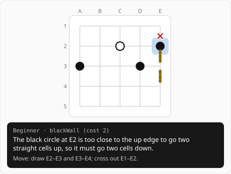</a>

*ARMORY-10 (5×5, the empty board). Click the picture to open this puzzle in the app.*

> Hint says: "The black circle at E2 is too close to the up edge to go two straight cells up, so it must go two cells down."

---

### blackAdjacent

*Beginner, cost 3*

Two touching black circles cannot connect, so each extends two cells away from the other.

*ARMORY-12 (8×8, after 4 earlier hints). Click the picture to open this puzzle in the app.*

> Hint says: "The touching black circles at E8 and F8 cannot connect (each must go straight through its neighbor), so E8 goes two cells left."

---

### whiteMustTurn

*Beginner, cost 3*

A white circle that goes straight at one end must turn at the other.

<a href="../index.html?book=armory&puzzle=13">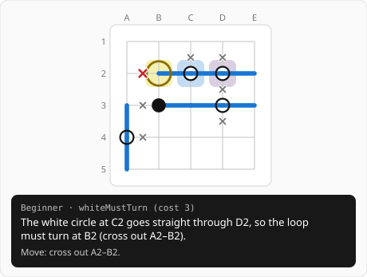</a>

*ARMORY-13 (5×5, after 5 earlier hints). Click the picture to open this puzzle in the app.*

> Hint says: "The white circle at C2 goes straight through D2, so the loop must turn at B2 (cross out A2–B2)."

---

### deadEnd

*Beginner, cost 4*

An empty cell with fewer than two exits left cannot be on the loop.

<a href="../index.html?book=armory&puzzle=14">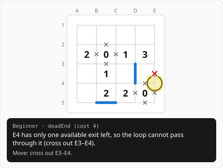</a>

*ARMORY-14 (5×5, after 3 earlier hints). Click the picture to open this puzzle in the app.*

> Hint says: "E4 has only one available exit left, so the loop cannot pass through it (cross out E3–E4)."

---

### forcedExits

*Beginner, cost 4*

A loop cell with only two exits left must use both.

<a href="../index.html?book=armory&puzzle=15">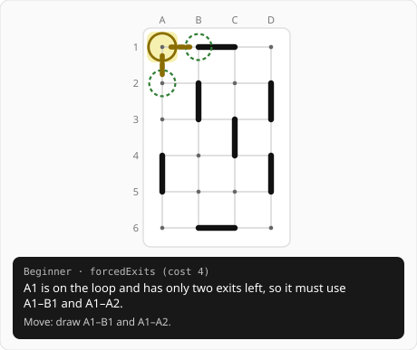</a>

*ARMORY-15 (4×6, the empty board). Click the picture to open this puzzle in the app.*

> Hint says: "A1 is on the loop and has only two exits left, so it must use A1–B1 and A1–A2."

---

### blackPerp

*Beginner, cost 5*

A black circle cannot enter a neighbor that already has a perpendicular segment.

<a href="../index.html?book=armory&puzzle=16">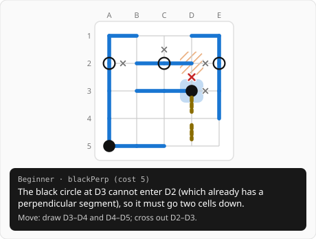</a>

*ARMORY-16 (5×5, after 6 earlier hints). Click the picture to open this puzzle in the app.*

> Hint says: "The black circle at C3 cannot enter B3 (which already has a perpendicular segment), so it must go two cells right."

---

### noEarlyClose

*Beginner, cost 6*

A segment joining the two ends of one path would close the loop early.

<a href="../index.html?book=armory&puzzle=17">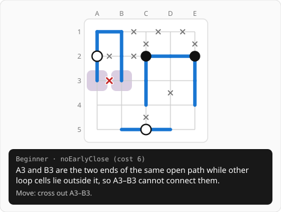</a>

*ARMORY-17 (4×6, after 5 earlier hints). Click the picture to open this puzzle in the app.*

> Hint says: "A5 and B5 are the two ends of the same open path while other loop cells lie outside it, so A5–B5 cannot connect them."

---

### threeWhites

*Beginner, cost 8*

Three white circles in a row must all cross perpendicular to the row.

*ARMORY-18 (5×5, after 9 earlier hints). Click the picture to open this puzzle in the app.*

> Hint says: "Three white circles in a row (D2, C2, and B2) cannot go along the row because the middle circle would fail to turn at either end; all three must cross vertically."

---

## Medium

A puzzle is rated **Medium** when its hardest required step is in this tier: local multi-segment inferences, basic inside/outside shading, and 1-step local lookahead.

### whiteBothStraight

*Medium, cost 10*

A white circle cannot use an axis where both neighbors already continue straight.

*ARMORY-20 (6×6, after 22 earlier hints). Click the picture to open this puzzle in the app.*

> Hint says: "If the white circle at E4 went vertically, both ends would go straight without turning; so it must go straight horizontally."

---

### closingCell

*Medium, cost 11*

An empty cell whose only two exits meet one path cannot be on the loop.

<a href="../index.html?book=armory&puzzle=21">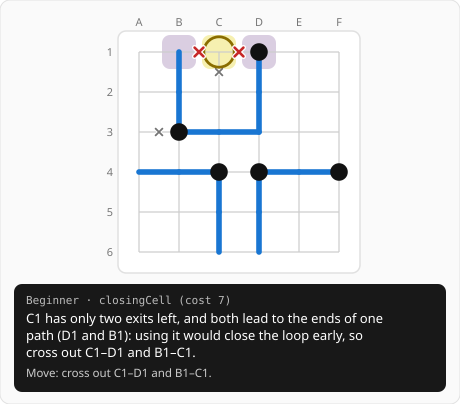</a>

*ARMORY-21 (6×6, after 17 earlier hints). Click the picture to open this puzzle in the app.*

> Hint says: "E3 has only two exits left, and both lead to the ends of one path (E4 and D3): using it would close the loop early, so cross out E3–E4 and D3–E3."

---

### samePathExits

*Medium, cost 11*

A loop cell with three exits where two meet one path must use the third.

<a href="../index.html?book=armory&puzzle=22">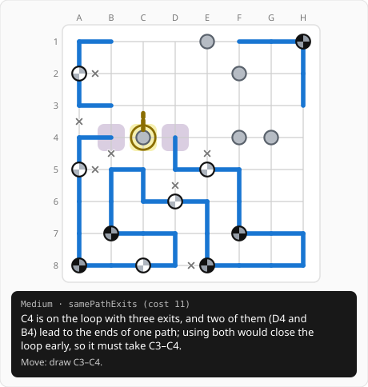</a>

*ARMORY-22 (8×8, after 6 earlier hints). Click the picture to open this puzzle in the app.*

> Hint says: "C3 is on the loop with three exits, and two of them (C4 and B3) lead to the ends of one path; using both would close the loop early, so it must take C2–C3."

---

### twoWhitesStraight

*Medium, cost 12*

Two touching white circles with a straight segment entering one cannot connect, so both cross perpendicular.

*ARMORY-23 (8×8, after 14 earlier hints). Click the picture to open this puzzle in the app.*

> Hint says: "The touching white circles at E4 and E5 cannot join because E2–E3 already continues straight past E4; both must go horizontally."

---

### whiteNoTurnAxis

*Medium, cost 14*

A white circle cannot use an axis whose two neighbors are both unable to turn.

*ARMORY-25 (8×8, after 32 earlier hints). Click the picture to open this puzzle in the app.*

> Hint says: "The white circle at D5 must turn at one of its two ends, so it cannot go vertically (D4 already goes straight and D6 has both turns blocked); it must go horizontally."

---

### blackNoEarlyClose

*Medium, cost 14*

A black circle cannot extend two cells into the other end of its own path and close the loop early.

<a href="../index.html?book=armory&puzzle=26">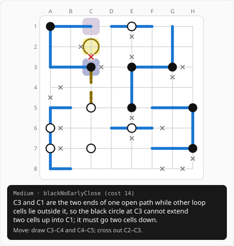</a>

*ARMORY-26 (8×8, after 22 earlier hints). Click the picture to open this puzzle in the app.*

> Hint says: "C3 and C1 are the two ends of one open path while other loop cells lie outside it, so the black circle at C3 cannot extend two cells up into C1; it must go two cells down."

---

### blackBlockedTarget

*Medium, cost 15*

A black circle cannot extend toward a circle two cells away that cannot accept a straight segment.

*No puzzle in the current corpus needed this rule as its cheapest next hint yet (cheaper rules resolved those positions first).*

---

### blackTwoDiagWhites

*Medium, cost 15*

A black circle flanked by two diagonally adjacent white circles cannot extend between them.

*ARMORY-27 (8×8, after 8 earlier hints). Click the picture to open this puzzle in the app.*

> Hint says: "The black circle at C3 cannot send a ray up between the two diagonal white circles at D2 and B2 (doing so would block whichever side its second leg takes); so it must go two cells down."

---

### blackWhiteNoTurn

*Medium, cost 16*

A black circle cannot extend into a white circle two cells away whose far side cannot turn.

*ARMORY-28 (8×8, after 12 earlier hints). Click the picture to open this puzzle in the app.*

> Hint says: "The black circle at E5 cannot extend into the white circle at C5 because B5 is another white circle, leaving C5 unable to turn on either side; so E5 must go two cells right."

---

### whiteCornerPinch

*Medium, cost 17*

A two-exit corner diagonally next to a white circle cannot pinch both of its already-active neighbors.

*ARMORY-29 (8×8, after 16 earlier hints). Click the picture to open this puzzle in the app.*

> Hint says: "G6 has only two exits left, pointing to F6 and G5, which both already have a segment; passing through G6 would fill both neighbors and cut off the white circle at F5 on both axes, so cross out F6–G6 and G5–G6."

---

### whiteDeadEndPinch

*Medium, cost 17*

A segment completing two sides of a 2×2 square beside a white circle cannot pinch both of its axes.

*ARMORY-30 (8×8, after 30 earlier hints). Click the picture to open this puzzle in the app.*

> Hint says: "Drawing B2–C2 would fill both C2 and B2, turning B3 into a dead end and cutting off the white circle at C3 on both axes; so cross out B2–C2."

---

### faceShade

*Medium, cost 18*

Basic inside/outside shading (crossing lines and X marks from the border) puts known colors on both sides of an edge.

*ARMORY-31 (8×8, after 13 earlier hints). Click the picture to open this puzzle in the app.*

> Hint says: "Inside/outside shading puts opposite sides (Outside and Inside) across A6–A7, so the loop must cross between them (draw A6–A7)."

---

### boxStrand

*Medium, cost 20*

Closing two active corners of a 2×2 square cannot seal off both escapes of an open end on the opposite side.

<a href="../index.html?book=armory&puzzle=32">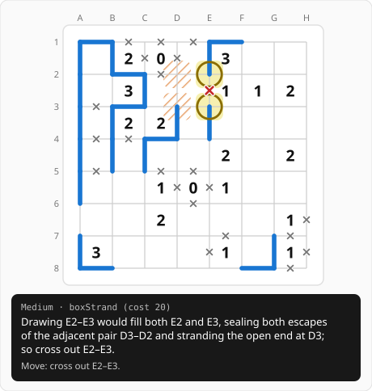</a>

*ARMORY-32 (8×8, after 30 earlier hints). Click the picture to open this puzzle in the app.*

> Hint says: "Drawing E2–E3 would fill both E2 and E3, sealing both escapes of the adjacent pair D3–D2 and stranding the open end at D3; so cross out E2–E3."

---

### imagineLocal

*Medium, cost 22–28 (dynamic)*

Imagine a segment on or off at a circle or open end: one local step immediately breaks a rule.

*ARMORY-44 (8×8, after 4 earlier hints). Click the picture to open this puzzle in the app.*

> Hint says: "Imagine a segment at E1–E2: then the 1 square E1–F2 already has 1 segment, so its other sides are off; and finally F1 is left with only one way out. So cross out E1–E2."

---

## Hard

A puzzle is rated **Hard** when its hardest required step is in this tier: circle-diagonal shading, global topology (pockets, chokepoints, paired ends), and short single-thread lookahead.

### corridorNoEarlyClose

*Hard, cost 30*

A forced multi-cell corridor joining the two ends of one path would close the loop early.

*ARMORY-33 (8×8, after 25 earlier hints). Click the picture to open this puzzle in the app.*

> Hint says: "The forced corridor (H1, G1, F1, E1, D1, C1, C2, C3, and C4) only connects the two ends of one open path (H2 and D4) while other loop cells lie outside it: entering it would close the loop early, so cross out 10 edges."

---

### faceCircle

*Hard, cost 38*

Advanced inside/outside shading (white-circle diagonals, black 3-to-1 corners, or relative coloring) forces an edge.

<a href="../index.html?book=armory&puzzle=35">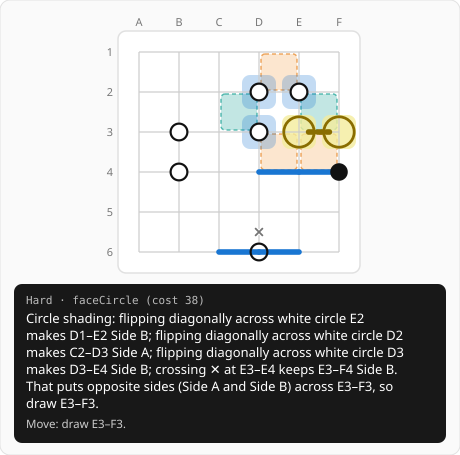</a>

*ARMORY-35 (8×8, after 7 earlier hints). Click the picture to open this puzzle in the app.*

> Hint says: "Circle shading: crossing line B1–C1 makes B1–C2 Inside; flipping diagonally across white circle B2 makes A2–B3 Outside. That puts Outside on both sides of A2–A3, so cross out A2–A3."

---

### twoEndsJoin

*Hard, cost 44*

A sealed area with just two open ends must connect them, so their far ends cannot join early.

<a href="../index.html?book=armory&puzzle=37">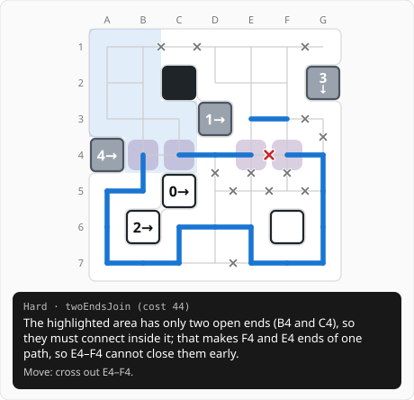</a>

*ARMORY-37 (8×8, after 20 earlier hints). Click the picture to open this puzzle in the app.*

> Hint says: "The highlighted area has only two open ends (G2 and H2), so they must connect inside it; that makes G4 and H4 ends of one path, so G4–H4 cannot close them early."

---

### chokepoint

*Hard, cost 48*

Blocking this segment would cut off a small area or leave a single chokepoint cell.

*ARMORY-38 (8×8, after 13 earlier hints). Click the picture to open this puzzle in the app.*

> Hint says: "Without H6–H7, F8 would be the only cell connecting the highlighted area to the rest of the loop (a single loop cannot pass through it twice), so H6–H7 must be drawn."

---

### parityPocket

*Hard, cost 52*

The other choice would seal off a small pocket with an odd number of open ends.

*ARMORY-39 (8×8, after 46 earlier hints). Click the picture to open this puzzle in the app.*

> Hint says: "If you tried drawing C3–C4, the highlighted area would be sealed off with 3 open ends (odd, so they can't all pair up); therefore cross out C3–C4."

---

### imagineTrace

*Hard, cost 36–75 (dynamic)*

Imagine a segment on or off and trace one single thread 2–3 steps ahead until something breaks.

*ARMORY-45 (8×8, after 7 earlier hints). Click the picture to open this puzzle in the app.*

> Hint says: "Imagine a segment at E2–F2: then the 1 square E1–F2 already has 1 segment, so its other sides are off; then the 1 square E2–F3 already has 1 segment, so its other sides are off; then E1 becomes a dead end; and finally the 3 square D1–E2 cannot reach 3 segments. So cross out E2–F2."

---

### crossingParity

*Hard, cost 58*

The loop crosses the border of any rectangle or band an even number of times.

*No puzzle in the current corpus needed this rule as its cheapest next hint yet (cheaper rules resolved those positions first).*

---

### chokepointArea

*Hard, cost 64*

Blocking this segment would cut off a large area or leave a single chokepoint cell.

*ARMORY-40 (8×8, after 19 earlier hints). Click the picture to open this puzzle in the app.*

> Hint says: "Without D4–D5, H7 would be the only cell connecting the highlighted area to the rest of the loop (a single loop cannot pass through it twice), so D4–D5 must be drawn."

---

### parityForces

*Hard, cost 68*

The other choice would seal off an area with an odd number of open ends.

<a href="../index.html?book=armory&puzzle=41">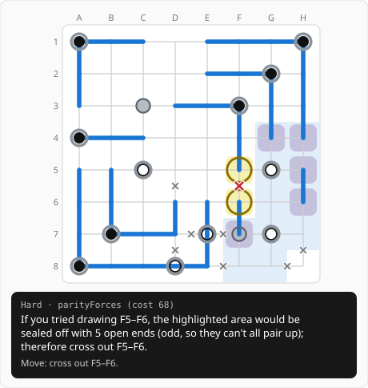</a>

*ARMORY-41 (8×8, after 38 earlier hints). Click the picture to open this puzzle in the app.*

> Hint says: "If you tried drawing F5–F6, the highlighted area would be sealed off with 5 open ends (odd, so they can't all pair up); therefore cross out F5–F6."

---

### symmetry

*Hard, cost 70*

A puzzle with exact symmetry and a unique solution must have a symmetric loop.

<a href="../index.html?book=armory&puzzle=42">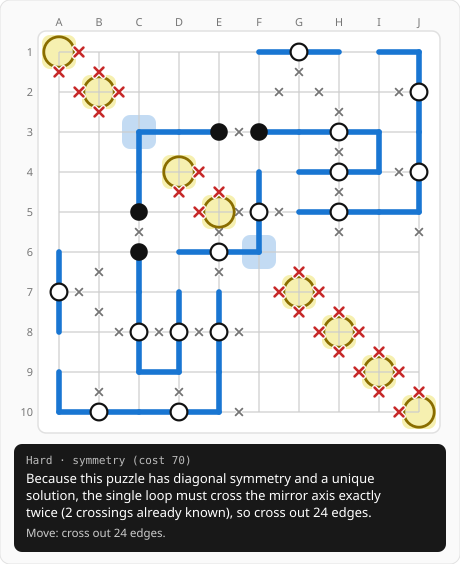</a>

*ARMORY-42 (10×10, after 32 earlier hints). Click the picture to open this puzzle in the app.*

> Hint says: "Because this puzzle has diagonal symmetry and a unique solution, the single loop must cross the mirror axis exactly twice (2 crossings already known), so cross out 24 edges."

---

## Expert

A puzzle is rated **Expert** when its hardest required step is in this tier: long or multi-front lookahead chains, full multi-rule trial and error, or beyond what Hint can explain.

### imagineChain

*Expert, cost ≥ 80 (dynamic)*

Imagine a segment on or off and follow a long, multi-front, or area-parity chain until something breaks.

*ARMORY-45 (8×8, after 8 earlier hints). Click the picture to open this puzzle in the app.*

> Hint says: "Imagine no segment at D1–E1: then the 3 square D1–E2 needs all of its remaining open sides; then D1 must use C1–D1; then C1 must use C1–C2; then E1 must use E1–F1; and finally the 1 square E1–F2 ends up with too many segments. So draw D1–E1."

---

### tryEdge

*Expert, cost 120*

Trying a segment one way leads to a contradiction.

<a href="../index.html?book=armory&puzzle=43">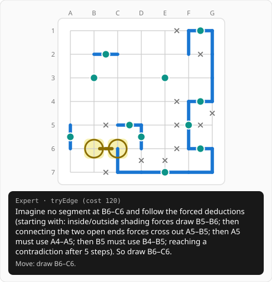</a>

*ARMORY-43 (8×8, after 15 earlier hints). Click the picture to open this puzzle in the app.*

> Hint says: "Imagine no segment at B6–C6 and follow the forced deductions (starting with: the black circle at C6 is blocked left and goes two cells right; then the white circle at D5 must go horizontally; then the black circle at C6 cannot enter C5 and goes two cells down; reaching a contradiction after 3 steps). So draw B6–C6."

---

## Variant rules

Extra techniques used only in books with special rules:

### Gray circles

Each gray circle is secretly either a **white** or a **black** circle — figuring out which is part of the puzzle. Tap a gray circle in the app to label it as an optional note.

- Bookkeeping: `grayFromShape` (cost 1): A gray circle with two drawn segments resolves to white (straight) or black (turn).

#### grayMustBeBlack

*Beginner, cost 2*

A gray circle that cannot go straight along either axis must be black.

<a href="../index.html?book=armory&puzzle=7">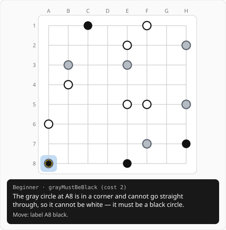</a>

*ARMORY-07 (8×8, the empty board). Click the picture to open this puzzle in the app.*

> Hint says: "The gray circle at A8 is in a corner and cannot go straight through, so it cannot be white — it must be a black circle."

---

#### grayMustBeWhite

*Beginner, cost 3*

A gray circle that cannot extend two straight segments along both axes must be white.

<a href="../index.html?book=armory&puzzle=11">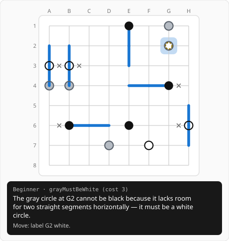</a>

*ARMORY-11 (8×8, after 2 earlier hints). Click the picture to open this puzzle in the app.*

> Hint says: "The gray circle at H6 cannot be black because it lacks room for two straight segments horizontally — it must be a white circle."

---

#### grayWhiteNoTurn

*Medium, cost 12*

A gray circle that cannot make a valid white-circle turn on either axis must be black.

<a href="../index.html?book=armory&puzzle=24">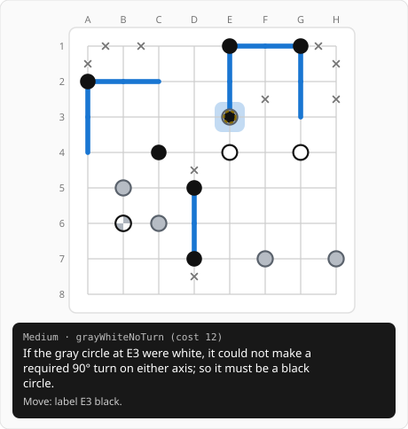</a>

*ARMORY-24 (8×8, after 22 earlier hints). Click the picture to open this puzzle in the app.*

> Hint says: "If the gray circle at F4 were white, it could not make a required 90° turn on either axis; so it must be a black circle."

---

### Hamilton cycle

The loop must visit **every** intersection dot on the grid (none may be left empty). Dark pre-filled segments and bold **✕** walls are permanent givens. Also combines with Masyu or Slitherlink in **Hybrids** books.

#### checkerPocket

*Medium, cost 18*

Checkerboard light/dark dot counts in a small full-board pocket force its exit segments.

<a href="../index.html?book=armory&puzzle=22">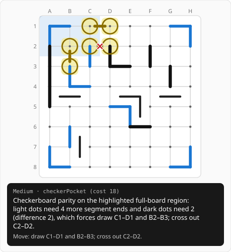</a>

*ARMORY-22 (8×8, after 8 earlier hints). Click the picture to open this puzzle in the app.*

> Hint says: "Checkerboard parity on the highlighted full-board region: light dots need 4 more segment ends and dark dots need 2 (difference 2), which forces draw C1–D1 and B2–B3; cross out C2–D2."

---

#### checkerParity

*Hard, cost 36*

Checkerboard light/dark dot counts in a full-board region force its exit segments.

<a href="../index.html?book=armory&puzzle=34">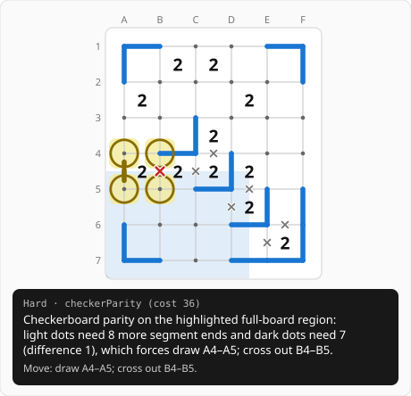</a>

*ARMORY-34 (8×8, after 8 earlier hints). Click the picture to open this puzzle in the app.*

> Hint says: "Checkerboard parity on the highlighted full-board region: light dots need 5 more segment ends and dark dots need 7 (difference 2), which forces draw A7–B7 and D7–E7; cross out B5–B6 and D5–D6."

---

### Swiss cheese

Cutout holes cannot be entered. Every enclosed hole lies entirely **Inside** or entirely **Outside** the loop (tap anywhere in a hole to shade it). All core Masyu techniques — especially border rules, `chokepoint`, `faceShade`, and `faceCircle` — work naturally around and across interior holes.

### Slitherlink & Hybrids

Each number **0–3** sits inside a grid square and tells how many of that square’s four sides belong to the single closed loop (blank squares can have any number of sides). In **Hybrids** books, numbered squares share the same single loop with Masyu circles or a Hamilton cycle.

#### slitherZero

*Beginner, cost 2*

A 0 square has no loop segments around it.

*ARMORY-01 (5×5, the empty board). Click the picture to open this puzzle in the app.*

> Hint says: "The 0 square at A4–B5 cannot touch any loop segments — cross out 4 edges."

---

#### slitherCount

*Beginner, cost 2*

A numbered square whose remaining edges match its count must fill or cross them out.

*ARMORY-02 (5×5, after 1 earlier hint). Click the picture to open this puzzle in the app.*

> Hint says: "The 3 square at B2–C3 needs every remaining open side to reach 3 — draw C2–C3, B3–C3, and B2–B3."

---

#### slitherCorner

*Beginner, cost 3*

A 3, 1, or 2 at a blocked corner forces its corner or outer extension segments.

*ARMORY-03 (5×5, the empty board). Click the picture to open this puzzle in the app.*

> Hint says: "Because corner E1 of the 1 square at D1–E2 has no exits outside the square, using either corner side would force both (two sides on a 1) — so cross out D1–E1 and E1–E2."

---

#### slitherAdjacent3

*Beginner, cost 5*

Two orthogonally adjacent 3s force three parallel segments and cross out the shared-vertex extensions.

<a href="../index.html?book=armory&puzzle=4">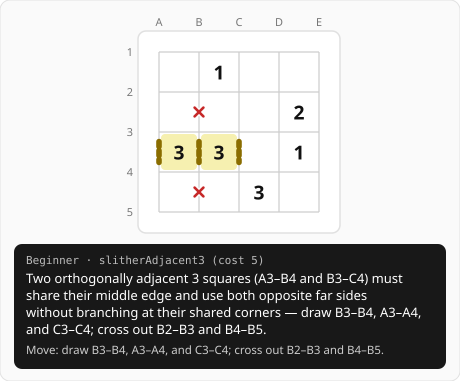</a>

*ARMORY-04 (5×5, after 1 earlier hint). Click the picture to open this puzzle in the app.*

> Hint says: "Two orthogonally adjacent 3 squares (A3–B4 and A4–B5) must share their middle edge and use both opposite far sides without branching at their shared corners — draw A4–B4 and A3–B3; cross out B4–C4."

---

#### slitherDiag3

*Beginner, cost 6*

Two diagonally adjacent 3s force both outer corners on.

*ARMORY-05 (6×6, after 9 earlier hints). Click the picture to open this puzzle in the app.*

> Hint says: "The diagonal 3 squares at D4–E5 and C5–D6 cannot both turn sharply around their shared corner D5, so each must use both of its outer sides — draw D4–E4, C6–D6, and C5–C6."

---

#### slither3LineIn

*Beginner, cost 6*

A segment entering a corner of a 3 forces its two opposite sides on and blocks the other exit.

<a href="../index.html?book=armory&puzzle=6">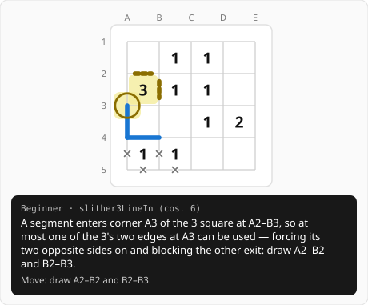</a>

*ARMORY-06 (5×5, after 4 earlier hints). Click the picture to open this puzzle in the app.*

> Hint says: "A segment enters corner A3 of the 3 square at A2–B3, so at most one of the 3's two edges at A3 can be used — forcing its two opposite sides on and blocking the other exit: draw A2–B2 and B2–B3."

---

#### slither1LineIn

*Medium, cost 12*

A segment forced into a corner of a 1 crosses out its two opposite sides.

<a href="../index.html?book=armory&puzzle=19">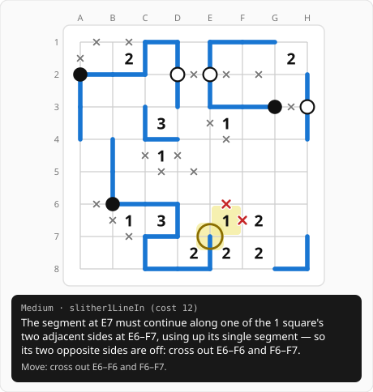</a>

*ARMORY-19 (8×8, after 4 earlier hints). Click the picture to open this puzzle in the app.*

> Hint says: "The segment at B1 must continue along one of the 1 square's two adjacent sides at B1–C2, using up its single segment — so its two opposite sides are off: cross out C1–C2 and B2–C2."

---

#### slitherDiag32

*Medium, cost 14*

A diagonal chain of 2s between two 3s forces both outer corners on.

*No puzzle in the current corpus needed this rule as its cheapest next hint yet (cheaper rules resolved those positions first).*

---

#### faceSlither

*Hard, cost 38*

Inside/outside shading around numbered Slitherlink squares (and circles on hybrids) forces an edge.

*ARMORY-36 (8×8, after 7 earlier hints). Click the picture to open this puzzle in the app.*

> Hint says: "Inside/outside shading: even/odd parity around the 1 square G6–H7 makes G7–H8 Inside. That puts opposite sides (Inside and Outside) across H7–H8, so draw H7–H8."

